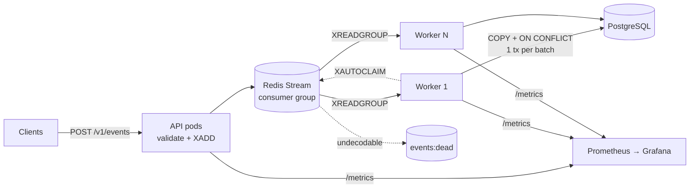

# go-event-ingestor

[](https://github.com/msalimcengiz/go-event-ingestor/actions/workflows/ci.yml)

A Go service for high-volume event tracking (page views, clicks, ad impressions). The HTTP API puts events into a **Redis Stream**. Workers then write them to **PostgreSQL** in batches with `COPY`. Under the same load this gives **2.8× the throughput** of writing each event directly and **~99.9% fewer Postgres commits** (see [Benchmark](#benchmark)).


## Try it in 2 minutes

**You need:** Docker with Compose v2, and `make`. Nothing else is installed on your machine: Go, k6 and the demo all run in containers.

```bash
git clone https://github.com/msalimcengiz/go-event-ingestor && cd go-event-ingestor
make demo     # starts the stack and walks through 8 checked steps (below)
make test     # unit tests
make test-integration   # integration tests against real Postgres and Redis
make bench    # direct vs buffered load test (k6)
make chaos    # SIGKILL workers and the API under load, then verify every event
make down     # stop and remove everything
```

`make demo` prints each step and fails loudly if something does not behave as described:

1. Requests without an API key get `401`.
2. A batch is accepted (`202`), buffered in Redis, and readable from Postgres via `GET /v1/events/{id}` shortly after.
3. A client retry with the same ids creates no duplicates.
4. An invalid event is rejected with `422` and the index of the bad event.
5. A message that cannot be decoded is moved to the `events:dead` stream.
6. With the workers stopped, the API answers `503` + `Retry-After` once the backlog passes `MAX_BACKLOG`.
7. The workers come back and every event accepted during the outage reaches Postgres.
8. The metrics show the backpressure rejection.

To explore by hand: `make up`, then the requests in [`requests.http`](requests.http) (VS Code REST Client or JetBrains HTTP Client) or the `curl` examples below. `make observability` adds Prometheus (`:9090`) and a provisioned Grafana dashboard (`:3300`).

| Port | Service |
|---|---|
| 8080 | API |
| 9090 / 3300 | Prometheus / Grafana (`make observability`) |



## Why

Writing every tracking event to the database inside the request causes three problems as traffic grows:

- Each event costs one transaction.
- Request latency is tied to database latency.
- A slow database turns into HTTP errors.

This service separates *accepting* an event from *storing* it:

| Concern | How it is handled |
|---|---|
| Fast accept | The API validates the events and sends one pipelined `XADD` per request. Response is `202`. |
| Fewer DB round trips | Workers flush when a batch reaches `BATCH_SIZE` or `FLUSH_INTERVAL` passes, whichever comes first. Each flush is one transaction: `COPY` into a temp table, then `INSERT … ON CONFLICT DO NOTHING`. |
| At-least-once, no duplicates | A message is acknowledged only after the commit. Redelivered messages and client retries reuse the event `id`, so the second write is a no-op. |
| Crashed workers | Messages a dead consumer read but never acknowledged are taken over with `XAUTOCLAIM` once they pass `CLAIM_MIN_IDLE`. |
| Poison messages | Messages that cannot be decoded go to `events:dead` with a reason and are acknowledged, so they do not block the group. |
| One bad row in a batch | Postgres rejects the whole `COPY` when a single row is invalid (for example `\u0000` in jsonb). On a data error (SQLSTATE class 22/23) the worker **splits the batch in halves** and retries each, which isolates the bad message in log₂(n) steps. Only that message is dead-lettered; the other rows are stored. |
| Database down | Transient errors leave the batch pending. It is reclaimed later and nothing is acknowledged, lost or dead-lettered (tested with a store that fails until "recovered"). |
| A message that never succeeds | `XPENDING` delivery counts. After `MAX_DELIVERIES`, the reclaimer dead-letters it instead of retrying forever. `ingestor dlq-replay [n]` moves dead letters back once the cause is fixed. |
| Unbounded stream / slow workers | There is **no `MAXLEN` on `XADD`**, because capping on write silently drops unread events when workers fall behind. Instead, workers `XTRIM MINID` up to the oldest pending entry, which only removes acknowledged entries (tested), and the API applies **backpressure**: `503` + `Retry-After` while backlog > `MAX_BACKLOG`. |
| Deploys | On `SIGTERM` the API reports not-ready, keeps serving for `SHUTDOWN_DELAY` so load balancers stop routing, then drains. Workers flush their last batch. |
| Authentication | `Authorization: Bearer <key>` against `API_KEYS`, compared in constant time. |
| Graceful shutdown | On `SIGTERM` the API drains in-flight requests and the worker flushes its last batch. |
| Horizontal scale | API and workers are separate deployments. Workers share one consumer group, so adding pods adds write capacity. |
| Baseline for comparison | `WRITE_MODE=direct` switches to one `INSERT` per event, so the benchmark compares both modes with the same binary. |

## Benchmark

Run with `make bench`. The k6 run uses 100 virtual users for 30 s, each request carrying 10 events. Postgres commits come from `pg_stat_database.xact_commit`. Measured on an Apple M4 in a Colima VM with 4 vCPU and 6 GB, with the whole stack in Docker on the same machine (API limited to 2 CPU, two workers, Postgres 17, Redis 7.4).

| mode | events/s | p50 ms | p95 ms | p99 ms | 2xx % | Postgres commits | rows stored |
|---|---:|---:|---:|---:|---:|---:|---:|
| direct | 18,175 | 54.5 | 63.4 | 73.2 | 100.00 | 528,231 | 539,150 |
| buffered | **50,811** | **13.3** | **45.1** | 66.3 | 100.00 | **1,547** | 1,488,520 |

- **2.8×** throughput and **4×** lower median latency.
- Commits per stored event drop from **0.98 to 0.001**, about 1,000 events per transaction.
- Every accepted event reached Postgres. The script waits for the stream to drain before it counts rows.

These numbers come from a laptop, not production hardware. The useful part is the ratio between the two modes, which you can reproduce with one command.

## Chaos test

Run with `make chaos` ([`bench/chaos.sh`](bench/chaos.sh)). A k6 producer (50 VUs, 60 s, 10 events per request) generates its own event ids and **retries a failed request with the same ids**. Meanwhile **both workers are killed with `SIGKILL` every 6 s and the API every 18 s**.

Every acknowledged request is then checked individually against Postgres:

| requests acknowledged | events stored | acknowledged but lost | duplicate rows | dead-lettered | containers killed |
|---:|---:|---:|---:|---:|---:|
| 64,628 | 646,280 | **0** | **0** | 0 | 14 |

Redis runs with `appendfsync everysec`, so a Redis crash (not tested here) can lose up to about one second of acknowledged events. Where that matters, use `appendfsync always`, or a replica with `WAIT` before acknowledging.

## Run it

Only Docker is required. Go and k6 run in containers.

```bash
make up                  # API on :8080, 2 workers, Postgres, Redis
curl -XPOST localhost:8080/v1/events -H 'Authorization: Bearer dev-key' \
  -d '[{"type":"click","user_id":"u1","payload":{"campaign_id":7}}]'
make observability       # + Prometheus :9090 and Grafana :3300 (dashboard "Event Ingestor")
make test                # unit tests
make test-integration    # + integration tests against real Postgres/Redis
make bench               # direct vs buffered
make chaos               # SIGKILL workers and API under load, verify every event
make k8s-validate        # kustomize build + kubeconform
```

### API

`POST /v1/events` accepts one event object or an array of up to 1,000 events.

```json
{ "id": "optional-uuid-for-idempotency", "type": "click", "user_id": "u1",
  "occurred_at": "2026-10-01T12:00:00Z", "payload": { "any": "json object" } }
```

| Status | Meaning |
|---|---|
| `202` | `{"accepted": n, "ids": [...]}` |
| `401` | Missing or wrong API key |
| `400` | Malformed JSON, or an empty or oversized batch |
| `413` | Body exceeds `MAX_BODY_BYTES` |
| `422` | Validation error, with the `index` of the bad event. Nothing is stored. |
| `503` | Buffer unavailable, or backpressure (with `Retry-After`). Retry with the same `id`s. |

`GET /healthz` is the liveness check, `GET /readyz` checks Postgres and Redis, and `GET /metrics` serves Prometheus metrics.

### Configuration

| Variable | Default | |
|---|---|---|
| `WRITE_MODE` | `buffered` | `buffered` or `direct` |
| `BATCH_SIZE` | `1000` | Maximum events per flush |
| `FLUSH_INTERVAL` | `500ms` | Maximum wait before a partial batch is flushed |
| `CLAIM_MIN_IDLE` | `30s` | How long a pending message waits before another worker takes it over |
| `MAX_BACKLOG` | `2000000` | Undelivered + pending entries above which the API returns 503 |
| `MAX_DELIVERIES` | `10` | Deliveries before a message is dead-lettered |
| `API_KEYS` | (empty: auth off) | Comma-separated bearer keys |
| `SHUTDOWN_DELAY` | `5s` | Time to keep serving after SIGTERM while not ready |
| `POSTGRES_URL`, `REDIS_ADDR`, `HTTP_ADDR` | local defaults | |

## Metrics

The service exports these metrics:

- **Throughput:** `ingestor_events_accepted_total`, `ingestor_events_persisted_total`, `ingestor_http_request_duration_seconds`, `ingestor_batch_size`, `ingestor_flush_duration_seconds`
- **Backlog:** `ingestor_stream_lag`, `ingestor_stream_pending`, `ingestor_stream_length`
- **Failures:** `ingestor_flush_errors_total`, `ingestor_messages_reclaimed_total`, `ingestor_dead_lettered_total`, `ingestor_batch_splits_total`, `ingestor_backpressure_rejections_total`, `ingestor_stream_trimmed_total`

The Grafana dashboard is provisioned from [`deploy/grafana`](deploy/grafana). Prometheus alert rules in [`deploy/prometheus/alerts.yml`](deploy/prometheus/alerts.yml) fire when events are dead-lettered, when the backlog keeps growing, when backpressure is active, and when nothing reaches Postgres.

## Kubernetes

[`deploy/k8s`](deploy/k8s) contains a kustomize base:

- API `Deployment` with an HPA on CPU, a PodDisruptionBudget and a zero-downtime rolling update.
- Worker `Deployment` that uses the pod name as its consumer name.
- Readiness and liveness probes.
- Non-root, read-only root filesystem, and all capabilities dropped.

The Postgres URL is read from a `Secret`.

## CI

[`.github/workflows/ci.yml`](.github/workflows/ci.yml) runs these jobs:

- gofmt and `go vet`
- Unit and integration tests with `-race` against Postgres and Redis service containers
- golangci-lint
- kubeconform on the rendered manifests
- A multi-arch image build. Pushes to `main` publish it to GHCR.

## Layout

```
cmd/ingestor        entrypoint: api | worker | all
internal/api        HTTP handler, validation errors, metrics middleware
internal/batch      generic size/time batcher (unit tested)
internal/stream     Redis Stream producer, consumer group, reclaim, dead-letter
internal/store      pgx pool, COPY-based batch insert, embedded migrations
internal/worker     ties the stream, batcher and store together
bench/              k6 script + direct vs buffered runner
deploy/             k8s, Prometheus, Grafana
```

## License

MIT
